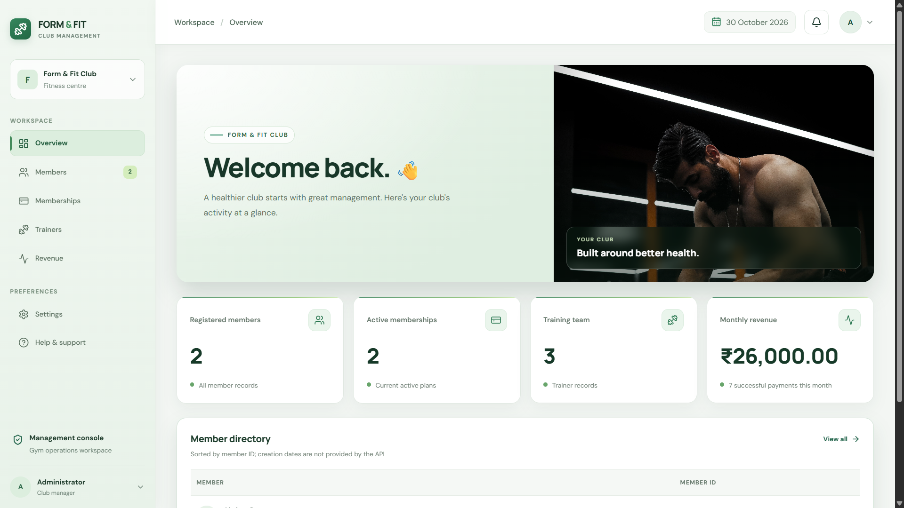
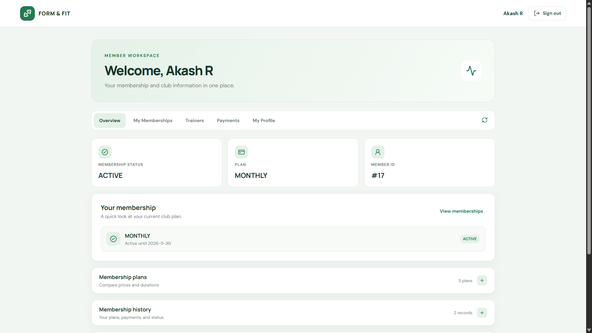
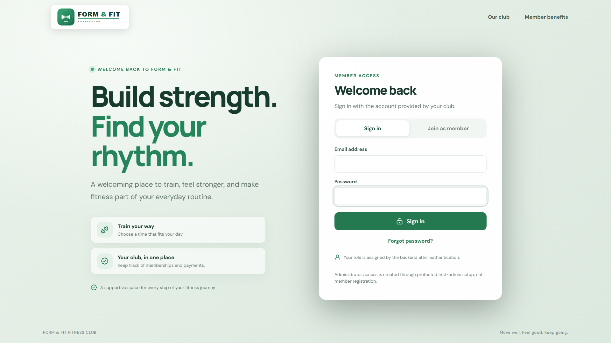

# 🏋️ Form & Fit Gym Management System

### From the original Swing desktop app to a modern microservices platform

  
  
  
  
  

---

## 🌿 Project overview

Form & Fit is a gym management application with two generations. Version 1 is the original Java Swing desktop app. Version 2 is the current web platform: a React experience connected to Spring Boot microservices through an API Gateway.

| Edition | Application | Technology | State |
| --- | --- | --- | --- |
| **Version 1** | Original desktop application | Java Swing, JDBC, MySQL | Preserved |
| **Version 2** | Web app and microservices | React, Spring Boot, PostgreSQL, Docker Compose | Active |

## ✨ Version 2 features

- 🧑‍💼 **Administrator workspace:** overview, member directory, membership plans, trainers, revenue reports, settings, and help.
- 🧍 **Member workspace:** membership status and history, trainers, payment history, and profile.
- 🪪 **Account security:** email-code member registration, password reset, and verified email replacement.
- 🏋️ **Trainer management:** create, edit, search, filter, and remove trainers; maintain specialization, availability, and status.
- 📅 **Membership lifecycle:** monthly, quarterly, and yearly plans; administrator assignment; member enrollment, cancellation, renewal, and history.
- 💳 **Razorpay:** server-created orders, signature verification, idempotency, and signed webhook processing. Use Test Mode while developing.
- 🧾 **Payment receipts:** branded Form & Fit email with amount paid and membership coverage dates.
- 📊 **Revenue:** monthly and yearly totals and successful payment details by member and plan.
- 📱 **Responsive UI:** mobile and desktop views, plus auto-dismissing action notices.
- 🔐 **Access control:** backend JWT authentication and role authorization.

### 🖼️ Version 2 screenshots

 <em>Administrator workspace</em>

 <em>Member portal and active membership</em>

 <em>Sign in and member account access</em>

## 🧭 Version 2 services

| Component | Port | Responsibility |
| --- | ---: | --- |
| React / Nginx frontend | **3000** | Administrator and member web app |
| API Gateway | **8083** | Routes /api requests and validates JWT |
| Member Service | **8081** | Member records and profiles |
| Membership Service | **8082** | Plans, assignment, enrollment, renewal, and cancellation |
| Trainer Service | **8084** | Trainer records and filters |
| Auth Service | **8085** | Registration, login, email codes, password reset, JWT |
| Payment Service | **8086** | Razorpay, verified payments, receipts, and revenue reports |

~~~text
Browser :3000
  └── API Gateway :8083
        ├── Auth Service       :8085 ── gym_auth_db
        ├── Member Service     :8081 ── gym_member_db
        ├── Membership Service :8082 ── gym_membership_db
        ├── Trainer Service    :8084 ── gym_trainer_db
        └── Payment Service   :8086 ── gym_payment_db
                 ├── Membership Service: plan pricing and activation
                 ├── Member Service: receipt recipient details
                 └── Razorpay: checkout and signed payment events

PostgreSQL runs on the host and Compose connects using host.docker.internal.
~~~

### 🧰 Technology

| Area | Technology |
| --- | --- |
| Web | React 19, Vite, Lucide icons, Nginx |
| Backend | Java 25, Spring Boot 4.1.2, Spring Security |
| Services | REST, Spring Cloud Gateway, JWT |
| Storage | Spring Data JPA, Hibernate, PostgreSQL |
| Payments and email | Razorpay Checkout/webhooks, Spring Mail, HTML email templates |
| Local stack | Docker, Docker Compose |

## 🚀 Run Version 2 with Docker Compose

### Requirements

- Docker Desktop with Docker Compose
- PostgreSQL running on the host
- Private microservices/.env configured from microservices/.env.example
- Razorpay Test Mode credentials for checkout
- SMTP credentials for verification and receipts

Create the databases used by the services:

~~~sql
CREATE DATABASE gym_auth_db;
CREATE DATABASE gym_member_db;
CREATE DATABASE gym_membership_db;
CREATE DATABASE gym_trainer_db;
CREATE DATABASE gym_payment_db;
~~~

From the repository root in PowerShell:

~~~powershell
Copy-Item microservices/.env.example microservices/.env
notepad microservices/.env
cd microservices
docker compose up -d --build
docker compose ps
~~~

Configure your own local values in the private .env file. Do not commit or share it. Open the app at **http://localhost:3000** and the gateway at **http://localhost:8083**.

After changing one service, rebuild it from the microservices folder:

~~~powershell
docker compose up -d --build --no-deps --force-recreate payment-service
~~~

Use the changed service name in place of payment-service. Stop the stack with docker compose down.

To run the frontend separately, use npm install and npm run dev from frontend while the gateway and services are running.

## 🔌 API quick reference

Base URL: **http://localhost:8083**. Protected endpoints require a backend-issued bearer token.

| Area | Routes |
| --- | --- |
| Auth | POST /api/auth/login, POST /api/auth/register/request-code, POST /api/auth/register/complete, POST /api/auth/password/request-code, POST /api/auth/password/reset |
| Members | /api/members, /api/members/me |
| Memberships | /api/memberships/plans, /api/memberships/me, /api/memberships/me/renewals, /api/memberships/me/{id}/cancel |
| Trainers | /api/trainers, /api/trainers/page, /api/trainers/search |
| Payments | POST /api/payments/orders, POST /api/payments/verify, GET /api/payments/history, POST /api/payments/webhooks/razorpay |
| Revenue | GET /api/payments/admin/revenue/monthly, GET /api/payments/admin/revenue/report?period=MONTHLY&year=2026&month=10 |

Revenue reports support MONTHLY and YEARLY periods. They total successful payments and return paginated member and plan details. Webhook events require a valid Razorpay signature. Internal endpoints are for service-to-service use only.

## 🔐 Configuration and safe operation

- Keep credentials in the private .env file and use .env.example only as a template.
- Configure JWT signing, internal-service authentication, database access, SMTP, Razorpay keys, and webhook secret locally.
- Keep Razorpay in Test Mode during development.
- The backend confirms payments; a browser checkout result alone is not proof of payment.
- Hibernate ddl-auto: update is used in the local setup. Back up local data before entity changes.
- Production hosting, secrets management, and versioned database migrations require separate setup.

### Health checks

- Gateway: http://localhost:8083/actuator/health
- Auth: http://localhost:8085/actuator/health
- Member: http://localhost:8081/actuator/health
- Membership: http://localhost:8082/actuator/health
- Trainer: http://localhost:8084/actuator/health
- Payment: http://localhost:8086/actuator/health

## 🛣️ Next improvements

- 🧪 Expand integration coverage across databases and service boundaries.
- 🗃️ Add reviewed, versioned database migrations.
- ☁️ Document production deployment, managed secrets, and monitoring.
- 📈 Continue improving reports, accessibility, and the member experience.

---

# 🖥 Version 1.0.0 — Original Desktop Application

V1 is the original Gym Management System, developed using **Java Swing, JDBC, and MySQL**. Its implementation and release history are preserved in this repository.

## ✨ V1 Features

### 👤 Member Features

- ✅ Secure member login.
- ✅ Member dashboard.
- ✅ View membership information.
- ✅ Access workout schedules.
- ✅ View payment information.
- ✅ Receive notifications.

### 🛠 Admin Features

- ✅ Add new members.
- ✅ Update member information.
- ✅ Delete member records.
- ✅ View registered members.
- ✅ Manage membership payments.
- ✅ Manage gym records.
- ✅ Access the admin dashboard.

## 🗄 V1 Database Integration

The desktop application uses MySQL and JDBC to store and retrieve gym-related information, including member records, payment information, workout schedules, and notifications.

## 📸 V1 Application Screenshots

### 👤 Member Dashboard

Interactive dashboard for members to view gym-related information.

### 🛠 Admin Dashboard

Administrative interface for managing gym operations.

## 🛠 V1 Technology Stack

| Category | Technology |
|---|---|
| Programming language | Java |
| GUI framework | Java Swing |
| Database | MySQL |
| Database connectivity | JDBC |
| IDE | Eclipse IDE |
| Version control | Git and GitHub |

## ▶️ Running V1 Locally

1. Clone the repository using the instructions above.
2. Open the original desktop project in Eclipse IDE.
3. Configure MySQL and initialize the database using the SQL script supplied with the project.
4. Update the local database connection settings in the existing source code.
5. Run the application's entry-point class.

The original desktop application's database setup and configuration are separate from the V2 PostgreSQL setup.

---

---

## 👨‍💻 Developed by Akshay R

Full Stack Developer · Java Developer · AI Enthusiast

  
  
  

## 🤝 Contributors

- **Akshay R** — Project development and integration.

## 📄 License

This project is licensed under the MIT License. See the LICENSE file for details.

**Version 1 preserved · Version 2 in active development**

